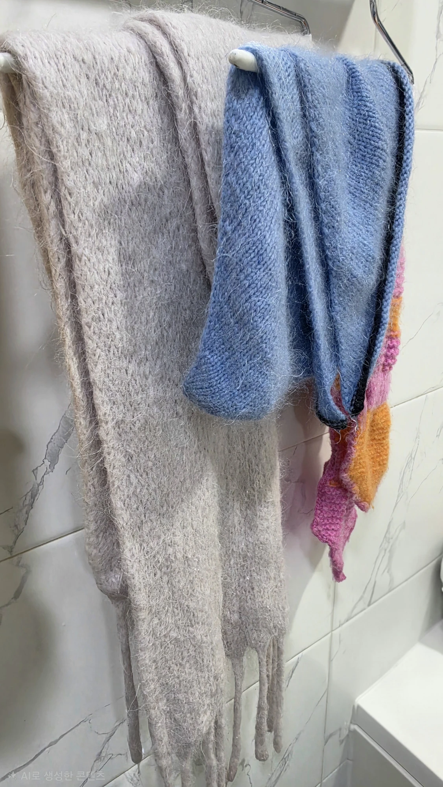
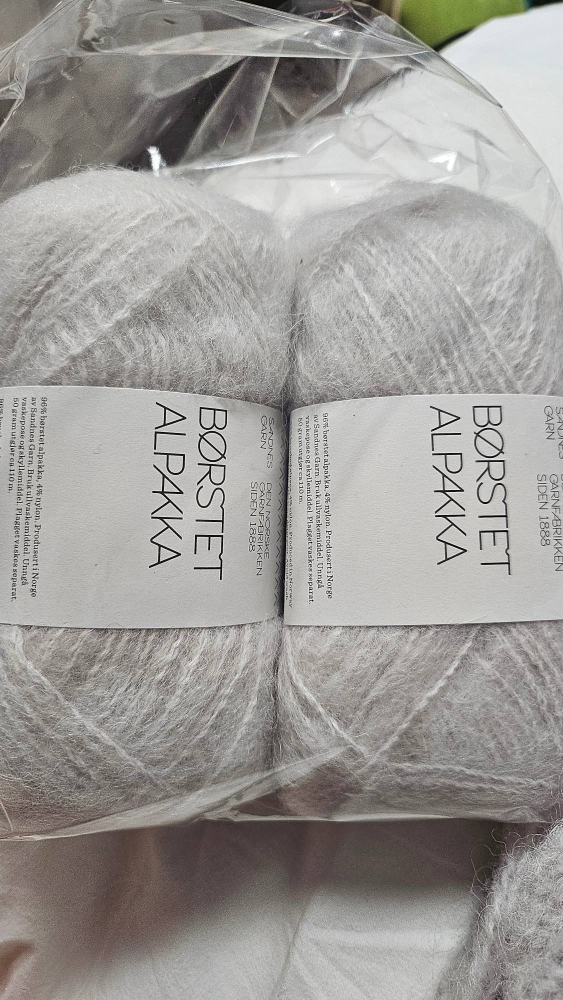
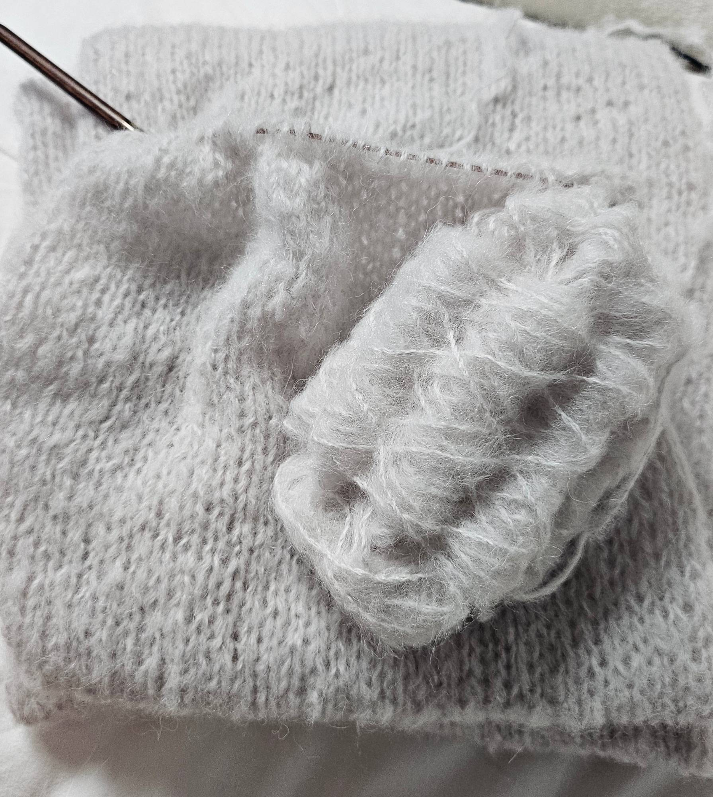
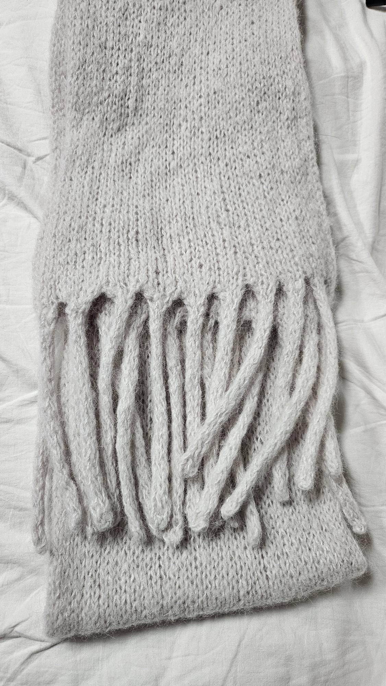
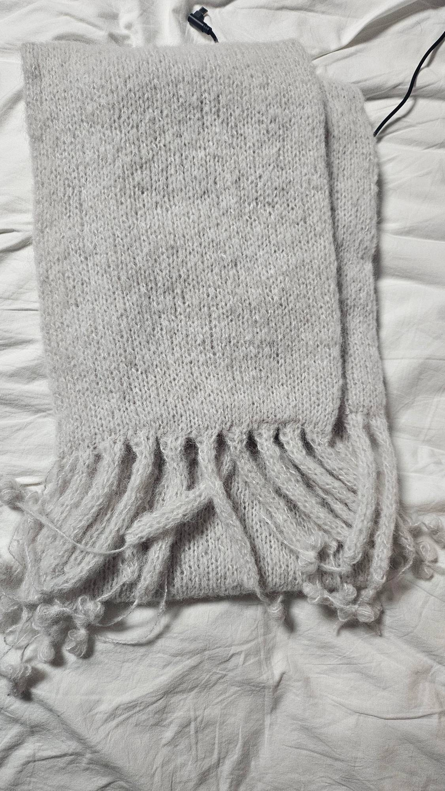
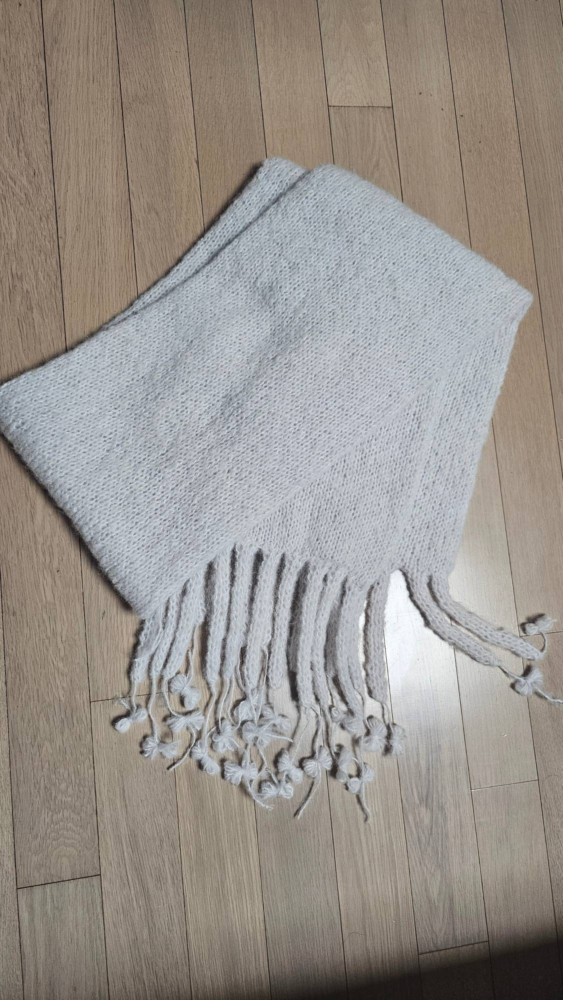
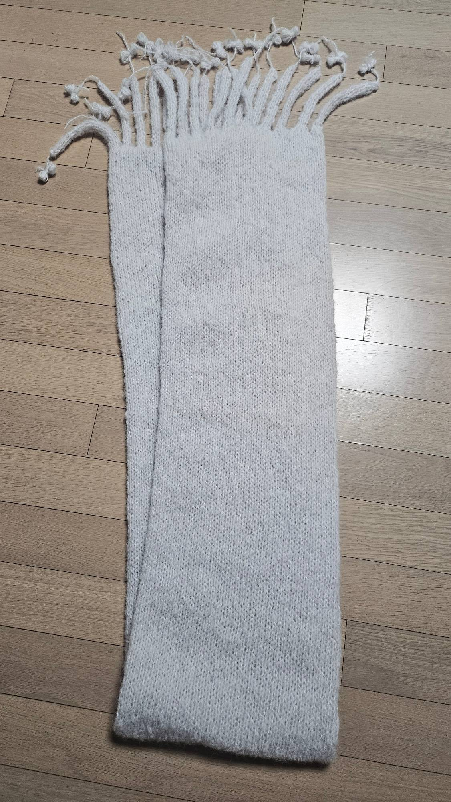

작년에 떠 준 베를린 스카프를 아이가 정말 좋아했어요.
올해도 날이 추워지니까 다시 맨다고 꺼내 달래요.
그래서 빨았죠.
빨다 보니 작년에 작업했던 게 생각나서 글을 쓰기 시작합니다.

떠 주기만 하면 끝일 줄 알았더니
해가 바뀌니 빨아서 잘 말리는 것도 내 몫인 걸 알게 되었네요.

## 엄마가 뭘 떠 주면 좋겠어?

원래는 스웨터를 떠 주고 싶었는데
아직 작품이 나올 정도의 실력이 아닌 것 같아서 아이에게 물어봤었답니다.
엄마가 뭘 떠 주면 좋겠냐고.

그때 아이 입에서 나온 게 베를린 스카프였답니다..
최소 180센티미터 이상으로 떠 달라는 요구를 곁들여서..

## 실 소진하려다 실 구매

원래는 집에 있는 실을 소진하기 위한 시작이었는데
요청한 스카프를 뜰 만한 실이 없더라구요.
그래서 또 구매.

아이 거니까 한 볼에 20,000원씩 7볼.
그러면 일단 재료비만 얼마인 건지..
그렇게 시작된 작업이었죠.

실은 산네스 간(Sandnes Garn)의 보르스테트 알파카(Børstet Alpakka).
노르웨이 실이라 라벨도 전부 노르웨이어예요.
알파카 96%, 나일론 4%. 한 볼에 50g, 약 110m.
7볼이면 350g에 770m 정도.
숫자로 보니까 더 비싸 보이네요..

봉지 뜯자마자 보송보송한 게
아.. 이래서 비싸구나 했어요.
그래도 한 번 더 계산은 했고요.

## 뜨는 중

줄바늘에 걸고 빙글빙글.
겉뜨기만 계속 가는 구간이라 손은 편한데
진도가 정말 안 나가요.
분명히 한참 떴는데 재 보면 그대로인 느낌.

180센티미터..
처음 들었을 땐 그냥 숫자였는데
뜨다 보니 이게 얼마나 긴 건지 알겠더라구요.
아이 키보다 길어요. 아마 내 키보다도.

## 진짜는 프린지

베를린 스카프의 묘미는 맨 아래 프린지예요.
몸판은 사실 거들 뿐.

프린지는 길이를 맞춰야 해서
뜨면서 바로 매듭짓지 않았어요.
일단 끝까지 다 뜨고, 매듭 없이 그대로 두기.

왜냐면 알파카는 빨면 늘어나거든요.
뜰 때 맞춰 놔 봤자 빨고 나면 또 달라져요.
그래서 완성하고 한 번 빨아서 말린 다음에
길이가 다른 것들을 하나하나 다시 조정했어요.

우리 아이는 이런 거 안 맞으면 싫어하는 아이라..
한 가닥이라도 삐죽 길면 바로 보이는 아이예요.
그래서 정말 완벽하게 맞추려고 노력했어요.
재고, 또 재고, 풀고, 다시 묶고.
레이스 버킷백 때는 푸르시오였다면 이번엔 재시오.

길이 다 맞추고 나서야 끝에 매듭.
이렇게 줄 맞춰 놓으니까
그제야 베를린 스카프 같더라구요.

## 드디어 180

그래서 완성.
바닥에 펼쳐 놓으니 끝이 안 보여요.
요구사항 180센티미터, 통과.
프린지 길이도, 통과. (아이 검수까지)

받고 나서 정말 좋아했어요.
작년 겨울 내내 잘 매고 다녔고요.
7볼 값은 그걸로 퉁치기로 했어요.

## 알파카 빨래는 이렇게

올해 다시 맨다고 해서 빨았는데
알파카는 빨래도 일이에요.

울 세제 풀고 찬물로.
헹굼은 여러 번. 거품이 안 나올 때까지.
마지막 헹굼에 섬유유연제.
그다음 욕실에서 물을 어느 정도 빼 주고
니트 전용 건조대에 뉘여서 말려요.

절대 걸어서 말리면 안 돼요.
물 먹은 알파카를 걸면
180이 200 되는 거 순식간이에요.
그럼 프린지 다시 맞춰야 되고요..
그건 진짜 싫어요.

라벨에도 울 세제 쓰고 따로 빨라고 써 있더라구요. 노르웨이어로.

떠 주면 끝인 줄 알았는데
빨고, 말리고, 다시 개 주는 것까지가 뜨개였네요.
올해 겨울도 잘 매 주세요.
