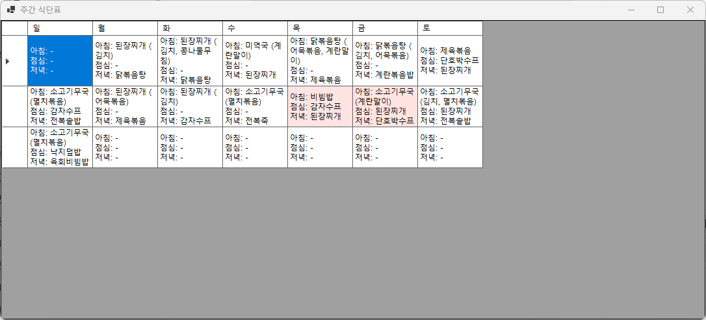

개발자는 코드 짜는 게 제일 재미있을 줄 알았는데, 막상 하루를 열어 보면 코드 짜는 시간이 반도 안 돼요.
에러 로그 뒤지고, 빌드 돌리고, 포맷 맞추고, 어제 내가 이걸 왜 이렇게 짰는지 기억 더듬고..
재미있는 건 조금이고 나머지는 전부 숙제 같아요.

게다가 직장맘은 식단 짜는 것도 일처럼 느껴지니까 (퇴근해서 해야 할 체크리스트에 메뉴 정해서 밥하기 뭐 이런 게 있었거든요) 이걸 클로드에게 시켜서 편해져야겠단 생각을 했어요.
시켜 놓고 매일 그걸 하던 시간에 나는 커피도 마시고, 뜨개질도 하고.. 아주 이상적이죠?

(그러니까 이건 퇴근해서 집에서 코딩을 시작했다는거죠)

이상적일 줄 알았어요. 처음엔.

## 시키는 것도 일이더라구요

말만 하면 되는 줄 알았거든요.
"식단표 만들어 줘" 하면 짠 하고 나올 줄 알았죠.

근데 시켜 보니까 내가 뭘 원하는지를 내가 모르는 거예요.
얼마 전에 주간식단표 프로그램을 시켰는데, 말이 한 줄이 아니라 한 화면이 됐어요.
평일엔 점심 없고, 저녁은 한 시간 안에 되는 걸로 만 원 넘으면 안 되고, 아침 국은 전날 끓여 둘 수 있는 것만, 표고버섯은 무조건 빼고, 어제 저녁이랑 오늘 아침에 같은 재료 나오면 안 되고..

하기 싫어서 넘겼는데 제일 머리 아픈 부분은 내가 하고 있는.. 이 억울함은 뭐죠.

그래도 한 번 말해 놓으면 그다음은 정말 편해요.
빌드 되고, 테스트 통과하고, 프로그램을 직접 띄워서 화면까지 찍어 오거든요.
한 번은 엉뚱한 창을 찍어 와서 "어, 이거 아닌데" 하고 있었더니, 내가 말하기도 전에 자기가 알아채고 다시 찍어 오더라구요.
(내 실수는 내가 잘 못 알아채는데 말이죠)

시키면서 정리해 보니 맡기기 좋은 건 대충 이런 것들이었어요.

- 한 번 정해지면 같은 모양으로 계속 반복되는 것. 포맷 검사나 테스트 돌리기 같은 거요.
- 내가 하면 세 시간 걸리는데 설명은 오 분이면 끝나는 것.
- 틀려도 되돌릴 수 있는 것.

## 내가 정해 둔 룰

클로드에게 주는 지침서 같은 파일이 하나 있어요.
매번 말하기 귀찮으니까 한 번 적어 두고 계속 읽게 만든 건데, 첫 줄이 이거예요.

> 사람이 직접 코드를 고치지 않는다.

오류가 나면 내가 손대지 말고, 원인 찾고, 고치고, 확인까지 끝까지 가라는 뜻이에요.
게으름을 이렇게 근엄하게 적어 놓을 수 있다니.. 쓰면서 나도 좀 웃었어요.

그 아래로는 이런 것들이 있어요.

- 뭘 고치든 빌드, 테스트, 포맷 검사 세 개가 다 통과해야 끝. "된 것 같아요"는 안 받아 줘요. (사람한테는 못 하는 말인데 클로드한테는 하게 되네요. 서운해하지 않으니까)
- 버그 하나 고치면 커밋도 하나. 이것저것 섞지 않기.
- 메일 발송이나 파일 삭제처럼 되돌릴 수 없는 건 반드시 나한테 물어보고 하기.

마지막 줄은 쓰고 나서야 제대로 이해했어요.
시킨 사람은 나인데 사고 치면 수습도 내가 하니까요.
일을 맡기는 건 편한데 책임까지 같이 넘어가는 건 아니더라구요.

## 시키다 보니 알게 된 것

이길 수 없는 경쟁자라서 친해지기로 했는데, 쉽게 친해지지는 않네요.

우리가 생각하는 친해지다는 상대방에 대해 어느정도 이해하고 알아야 하는건데, 그 쪽으로는 영 ..

다만 식단표 작업을 하면서 알게 된 건, 의외로 한 줄로 많은 걸 해준다.

예를 들어 주간식단표 짜는 프로그램을 만들어 줘 하면



짠 하고 만들지만,

<div style="height: 12px"></div>

그 상태에서 뭘 수정하려면 장황해진다는 것.

그래서 다시 한번 알게 된 건, 뭘 하고 싶은 건지 어디까지 하고 싶은 건지에 대한 내 생각 정리

그게 곧 개발계획서가 되겠죠.

이게 6할.

그리고 디자인이 2할.

나머지 2할은 클로드가 다 해주니까.. 전부지만 2할.

## 그 2할이 뭐였냐면

2할이라고 쓰긴 했는데 그 안에 들어 있는 게 생각보다 많아서 정리해 둘게요.
개발하시는 분들은 이쪽이 더 궁금하실 수도 있고요.

C#(.NET 10)으로 이렇게 나눠서 만들어 왔어요.

- Core: 메뉴·반찬·하루 식단 모델, 배치 알고리즘, 출력 코드
- ConsoleApp: 콘솔에 표로 찍어 보는 실행기 (공휴일 요일은 빨간 글씨)
- WinFormsDemo: 위에 있는 DataGridView 화면 (공휴일 칸은 연분홍 배경)
- Tests: 규칙별 단위 테스트 9개

시켰던 규칙 중에 구현이 눈에 띄는 것만 보면 이래요.

| 내가 말한 것 | 코드에서는 |
|---|---|
| 평일 아침은 전날 끓여 둔 국·탕·찌개 | 카테고리와 `IsMakeAhead` 조건으로 거르고 죽은 제외 |
| 표고버섯은 무조건 제외 | 후보 목록을 받을 때 처음부터 빼 둬서 어느 끼니에도 못 올라옴 |
| 국·탕·찌개엔 반찬 1~2개, 수프는 없음 | 반찬의 "어울리는 국 카테고리"로 맞춰서 랜덤 배정 |
| 붙은 끼니끼리 같은 재료 금지 | 주재료 목록의 교집합이 있는지 검사 |
| 공휴일은 하드코딩 금지 | (날짜, 휴일명) 딕셔너리를 밖에서 넣어 줌 |

제일 신경 쓴 건 조건이 안 맞을 때예요.
후보가 없다고 에러를 내거나 아무거나 슬쩍 넣으면 안 되니까, 조건을 단계별로 풀어 가게 만들었어요. 평일 저녁이라면 이렇게요.

```csharp
m => m.CookingMinutes <= 60 && m.UnitPrice <= 10_000m, // 원래 조건
m => m.CookingMinutes <= 60,                           // 단가 제한 완화
m => m.UnitPrice <= 10_000m,                           // 조리시간 제한 완화
_ => true,                                             // 최후: 전부 완화
```

앞 단계에서 후보가 나오면 거기서 멈추고, 풀 때마다 몇 번째 조건으로 완화했는지 로그에 경고를 남겨요.
재료가 겹치는 것도 못 피하면 마찬가지로 풀고 경고, 모든 단계를 풀어도 후보가 하나도 없으면 그 끼니를 비우고 에러 로그를 남기고요.
규칙을 지켰는지 못 지켰는지가 눈에 보여야 하니까요.

내가 안 정해 준 부분도 있었어요.
평일엔 점심이 없잖아요. 그러면 아침 다음 끼니는 저녁인데, 이 둘을 "붙은 끼니"로 볼지는 말을 안 했거든요.
클로드가 알아서 점심이 없는 날엔 아침과 저녁을 붙은 걸로 보기로 했더라구요.
맞는 판단 같긴 한데, 6할을 덜 채우면 이런 데서 클로드가 대신 정하는구나 싶었어요.

검증용 테스트는 후보를 딱 하나만 남겨 두는 식으로 짜서 랜덤이어도 결과가 고정돼요.
표고버섯국 하나만 있는 메뉴판을 주면 평일 아침이 비어 있어야 하고, 아침과 같은 감자가 든 저녁 후보랑 당근 후보가 같이 있으면 반드시 당근 쪽이 나와야 하고요.

클로드의 도움을 받아 정리하긴 했는데 이걸 한눈에 보도록 LLM-WIKI 같은 걸로 만들어 두면 좋겠네요..
다음엔 그걸 한 번 해볼게요.
