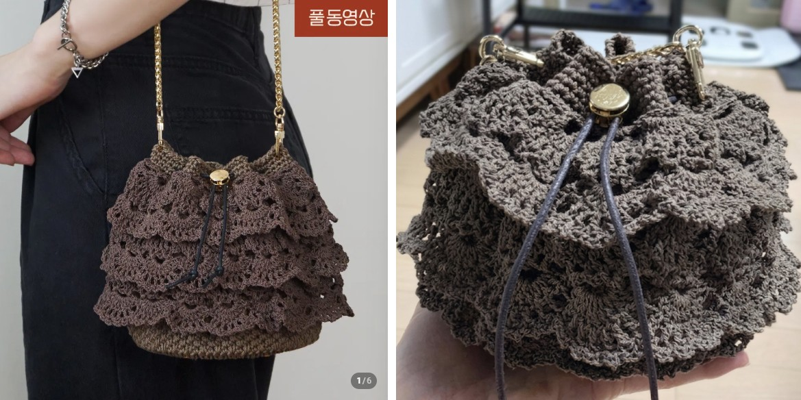

## 주문이 들어왔다

봄에 쇼핑하다가 가방 주문을 받았어요.
주문이래봤자 내가 재료 사서 내가 뜨고 돈도 못 받는 주문이지만 받았어요.

가게에 걸린 가방 보면서 "이런 거 너도 뜰 수 있지?" 하는데
못 한다고 하면 지는 것 같아서..
그 자리에서 "당연하지" 해버렸답니다.
지금 생각하면 그때 입을 막았어야 했는데.

## 상상씨에서 장바구니 채우기

집에 오자마자 상상씨 스토어에 들어갔어요.
실 따로 도안 따로 고를 자신은 없어서
재료랑 도안이 한 번에 들어 있는 [DIY 패키지](https://smartstore.naver.com/sangsangssi/products/11846004680)로 샀어요.
패키지는 이런 게 좋아요. 실 모자랄까 봐 걱정할 필요도 없고
"이 실 맞나?" 고민할 필요도 없고.
상자 열면 다 들어 있으니까 바로 시작하면 되거든요.

사실 처음에 원한 건 레드였어요.
빨간 레이스 버킷백.. 상상만 해도 예쁘잖아요.
근데 DIY 패키지에는 레드가 없더라구요.
브라운, 블랙, 그레이베이지, 아이보리 네 가지뿐.
한참 들여다보다가 결국 브라운으로.
레드는 마음속에 고이 접어 두고..

상자 열어 보니 이렇게 들어 있었어요.

- 코튼필드 1볼
- 코튼레이스 1볼 + 7g
- 가죽바닥(블랙), 왁스끈(블랙), 스토퍼(골드)

실이 두 종류라 바늘도 두 개 써요. 모사용 3/0호, 5/0호 코바늘.
돗바늘이랑 가위, 마커는 집에 있는 걸로.
난이도는 별 다섯 개 중에 세 개.
중간이면 할 만하겠지.. 했죠. 그때는.

바닥은 가죽이라 바닥 뜨는 수고는 없어요.
가죽 구멍에 코를 걸어서 몸판을 올리고,
그 위에 레이스를 층층이 둘러서 프릴처럼 만드는 가방이에요.
입구는 왁스끈으로 조이고 스토퍼로 고정하고요.
뭔가 있어 보이잖아요.

## 그리고 푸르시오

처음엔 정말 재미있게 만들었어요.
가죽바닥에 코 거는 것도 처음이라 신기하고.

그러다가 자꾸 삐뚤어져서..
몸판 올라가는데 한쪽으로 살짝 돌아가는 게 보이는 거예요.
레이스가 겉을 덮을 거니까 하고 위안을 삼았지만 하...
참을 수가 없어서. 자꾸 푸르시오.

한 번 풀면 그다음엔 더 잘하고 싶어지고
더 잘하고 싶으니까 더 신경 쓰이고
신경 쓰이니까 또 풀고.

눈 딱 감고 해야 하는데 왜 이럴 때만 처음부터 기초를 잘 잡고만 싶어지는지
회사에서는 일단 돌아가게 만들고 나중에 고치자 하면서..
가방 앞에서는 그게 안 되더라구요.

한 4번 풀고 다시 했나...
실이 자꾸 풀었다 떴다 하니까 나중엔 실도 좀 지쳐 보였어요.
나도 지쳤고.

## 완성

그러고 나서 완성한 가방이랍니다.

레이스 씌우고 나니까 확실히 예쁘긴 했어요.
삐뚤어진 거 레이스가 다 덮어주긴 하더라구요. (그럼 왜 풀었니...)

근데.
그냥 반짝이는 실로 할걸.
그렇게 열심히 했는데 반짝이질 않다니...
도안 사진에서 본 그 느낌이 아니야.
허무했는데

선물 받은 분이 산 것 같다고 좋다고 하셔서 (선물 받은 너 누구냐???)
아주 조금 위안을 받았답니다.
산 것 같다는 말이 뜨개 하는 사람한테는 최고의 칭찬이거든요.

## 그리고 다음 주문

옆에 있던 다른 분이 주문했지만.. 일단 모른 척
당분간 그들을 만나지 말아야겠어요..
푸르시오.. 너무 힘들었답니다.

원래는 하나 더 뜰 생각이었어요.
이번엔 실 따로 구해서 처음에 원했던 레드로.
반짝이 실로, 마커도 더 촘촘하게 걸고,
삐뚤어져도 한 번은 그냥 넘어가 보는 걸로.

근데 솔직히..
당분간은 이 가방 쳐다도 보기 싫어요.
레드는 조금만 더 접어 둘게요.
아주 조금만..

선물 받은 누구야!!
튼튼하게 떴으니, 줄이 끊어져도 묶어서 오래오래 들고 다녀주세요. 💛
