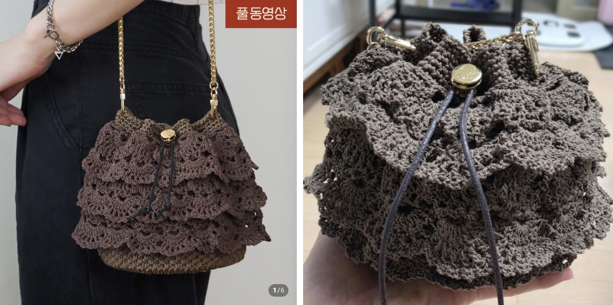

봄에 쇼핑하다가 가방 주문을 받았어요.
주문이래봤자 내가 재료 사서 내가 뜨고 돈도 못 받는 주문이지만 받았어요.

상상씨 사이트에 들어가서 재료와 도안을 구입하고,
정말 재미있게 만들다가...
자꾸 삐뚤어져서..
레이스가 겉을 덮을 거니까 하고 위안을 삼았지만 하...
참을 수가 없어서. 자꾸 푸르시오.
눈 딱 감고 해야 하는데 왜 이럴 때만 처음부터 기초를 잘 잡고만 싶어지는지
한 4번 풀고 다시 했나...

그러고 나서 완성한 가방이랍니다.

그냥 반짝이는 실로 할걸.
그렇게 열심히 했는데 반짝이질 않다니...
허무했는데
선물 받은 분이 산 것 같다고 좋다고 하셔서 (선물 받은 너 누구냐???)
아주 조금 위안을 받았답니다.

옆에 있던 다른 분이 주문했지만.. 일단 모른 척
당분간 그들을 만나지 말아야겠어요..
푸르시오.. 너무 힘들었답니다.

선물 받은 누구야!!
튼튼하게 떴으니, 줄이 끊어져도 묶어서 오래오래 들고 다녀주세요. 💛
