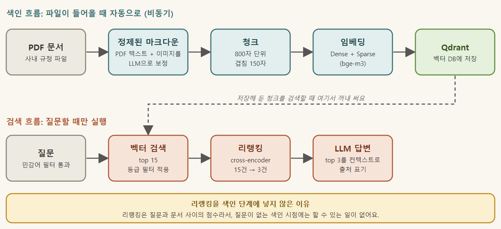
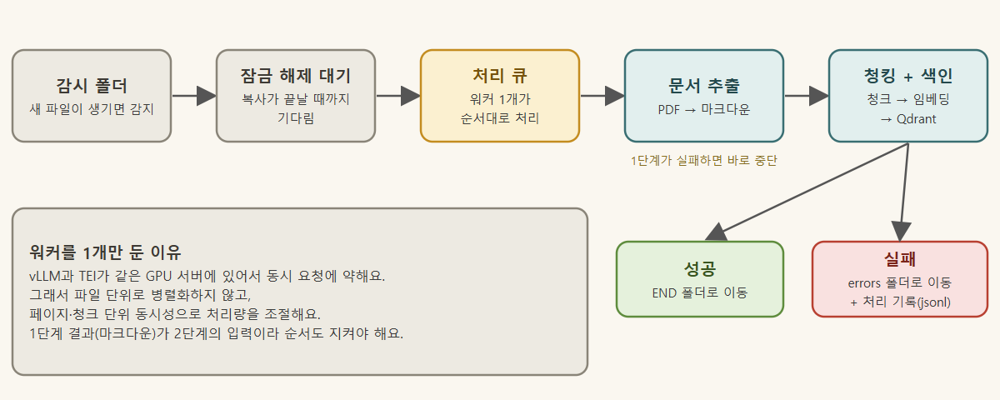
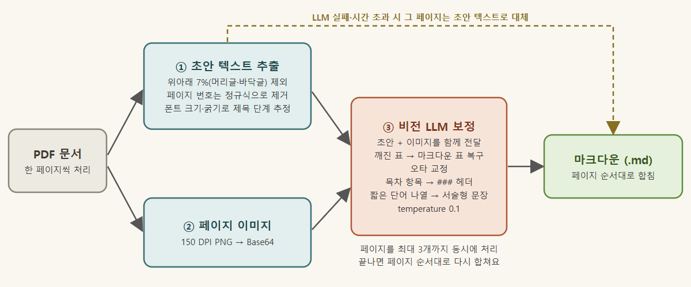
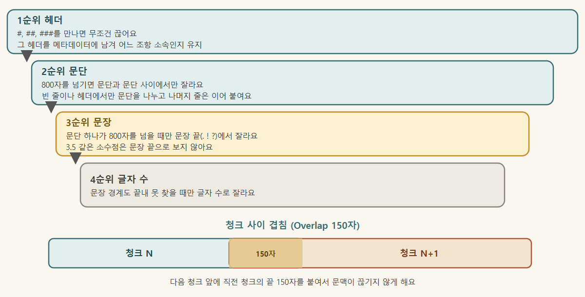
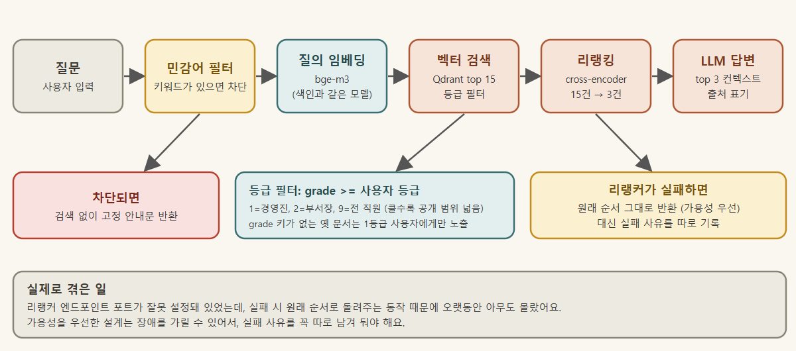
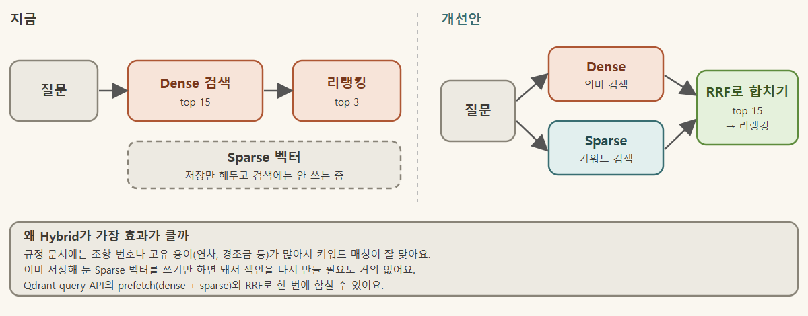

바이브 코딩이라고 하죠. AI에게 말로 전달해서 프로그램 만드는 걸.

챗봇을 그렇게 만들고 나니 결과는 있는데, 정작 내가 뭘 알고 있는지는 모르겠는 거예요.

그래서 다시 처음부터 공부하기 시작했어요.

그 공부마저 AI에게 도움을 받아야 했지만, 적어도 내가 뭘 하는지는 알고 싶어서 앱이 아니라 CLI 기반으로 다시 작업하면서 공부하기 시작했어요.

이번 글에서는 그 전체 흐름을 순서대로 정리해 보려고 합니다.

## 한눈에 보기

구조는 크게 두 갈래로 나뉜대요.

- **색인(Indexing):** 파일이 폴더에 들어오면 자동으로 처리해서 검색할 수 있는 상태로 만들어 두는 흐름 ( 지정된 폴더를 감시하다가 파일이 감지되면 파일을 읽어서 청킹과 임베딩등의 과정을 거쳐 백터DB에 저장되도록 하는 나름 자동화 시스템인거죠, 아래 좀더 자세히 설명할께요)
- **검색·생성(Retrieval·Generation):** 누가 질문할 때만 실행되는 흐름

*전체 파이프라인: 색인 흐름과 검색 흐름*

처음엔 리랭킹이 색인 쪽에 없는 게 좀 이상해 보였어요. 그런데 리랭킹은 질문과 문서를 비교해서 점수를 매기는 단계라, 질문이 없는 색인 시점에는 할 일이 없어요. 그래서 검색 쪽에만 들어가요.

쓴 기술은 아래와 같아요.

| 구성 요소 | 사용 기술 |
|---|---|
| 문서 정제 / 예상 QnA / 답변 생성 | vLLM + Qwen3.6-35B (NVFP4) |
| Dense 임베딩 | TEI + BAAI/bge-m3 (1024차원, Cosine) |
| Sparse 임베딩 | TEI /embed_sparse |
| 리랭커 | bge-reranker-v2-m3 |
| 벡터 DB | Qdrant |

## 1. 색인 파이프라인

### 1-1. 파일 감지와 큐

감시 폴더에 파일이 들어오면 에이전트가 알아서 처리해요. 순서는 이래요.

1. 파일 생성 이벤트 감지
1. 파일 잠금이 풀릴 때까지 대기 (복사 중인 파일을 읽지 않으려고요, 또는 내부 보안에 대한 처리같은 것을 확인도 해요)
1. 큐에 넣고 워커 1개가 순서대로 처리
1. 문서 추출, 청킹·색인 순서로 실행
1. 성공하면 END 폴더로, 실패하면 errors 폴더로 옮기고 처리 기록을 남기도록 했어요.

*색인 처리 흐름과 성공·실패 분기*

워커를 1개만 둔 건 이유가 있어요. vLLM이랑 TEI가 같은 GPU 서버에 올라가 있어서, 요청이 한꺼번에 몰리면 잘 버티지 못해요. 그래서 파일 단위로 병렬 처리하지 않고 페이지나 청크 단위에서 동시 처리 개수를 조절했어요. 또 1단계에서 나온 마크다운이 2단계 입력으로 들어가니까, 1단계가 실패하면 그 자리에서 멈추게 했어요. 사실 가장 큰 이유는 저희 내부에 자원이 별로 없었어요.  간신히 POC만 가능하달까. GPU는 너무 비싸서..

### 1-2. PDF를 제대로 읽기

PDF는 생각보다 까다로웠어요. 텍스트 레이어만 뽑으면 표가 다 깨지고, 비전 모델한테만 맡기면 글자를 엉뚱하게 읽어요. 그래서 둘을 섞었어요. 뽑아낸 초안 텍스트와 페이지 이미지를 같이 LLM에 넘기는 방식이에요.

*문서 추출과 정제 과정*

**초안 추출 (PdfPig)**

- 페이지 위아래 7%는 머리글·바닥글로 보고 뺐어요. 페이지 번호는 정규식으로 걸렀고요.
- 단어를 Y좌표 기준으로 묶어서 한 줄로 만들어요.
- 제목 단계는 폰트 크기와 굵기로 추정했어요. 16pt 이상은 #, 12~13pt에 굵은 글씨는 ##로요.

**페이지 렌더링 (PdfiumViewer)**

- 150 DPI PNG로 만들어서 Base64로 변환해요.

**비전 보정 (vLLM)**

이미지와 초안을 같이 보내서 이런 걸 시켜요.

- 깨진 표를 마크다운 표로 복구
- 오타 교정
- 목차 항목을 ### 헤더로 변환 (이게 나중에 청킹 기준이 돼요)
- 짧은 단어 나열은 문장으로 풀어 쓰기 (그래야 임베딩이 잘 돼요)

temperature는 0.1로 낮게 잡았어요. 응답에 `<think>` 블록이 섞여 나와서 정규식으로 지우고 있어요.

**동시성과 실패 처리**

페이지는 최대 3개씩 동시에 돌리고, 다 끝나면 원래 순서대로 합쳐요. vLLM이 실패하거나 시간이 초과되면 그 페이지만 초안 텍스트로 대신 넣어요. 페이지 하나 때문에 문서 전체를 날리는 건 아깝잖아요.

결과물은 파일 출처 헤더와 페이지 구분선이 들어간 .md 파일로 나와요.

### 1-3. 청킹 (Chunking)

설정값은 최대 800자, 겹침 150자예요. 자르는 규칙에는 우선순위를 뒀어요.

*청킹 우선순위와 겹침*

- **문단 재조합:** PDF에서 뽑은 줄바꿈은 대부분 화면상 줄바꿈이라 문장 중간에서 끊겨 있어요. 그래서 빈 줄이나 헤더가 나올 때만 문단을 나누고, 나머지는 이어 붙였어요.
- **헤더 경계:** #, ##, ###를 만나면 무조건 끊어요. 그 헤더는 current_header 메타데이터에 넣어 둬서, 청크가 어느 조항에 속하는지 알 수 있어요.
- **크기 경계:** 800자를 넘으면 문단과 문단 사이에서만 잘라요. 다음 청크 앞에는 바로 앞 청크의 마지막 150자를 ...와 함께 붙여서 문맥이 끊기지 않게 했어요.
- **긴 문단 처리:** 문단 하나가 800자를 넘을 때만 그 안에서 문장 끝(. ! ? 다음에 공백)을 찾아 잘라요. 3.5 같은 소수점은 문장 끝으로 치지 않아요. 문장 끝을 못 찾으면 그때 가서야 글자 수로 자르고요.

정리하면 헤더 > 문단 > 문장 > 글자 수 순서예요. 처음엔 그냥 줄 단위로 잘랐는데, 청크가 "~부여하며,"처럼 문장 중간에서 끝나 버리니까 검색 품질이 눈에 띄게 떨어졌어요. 어디서 자르느냐가 생각보다 훨씬 중요했어요.

### 1-4. 보강, 임베딩, 업서트

청크는 5개씩 병렬로 처리하고, 포인트가 50개 모이면 한꺼번에 업서트해요.

- **예상 QnA 생성:** 청크마다 LLM으로 예상 질문과 답을 3쌍씩 만들어 payload의 qna에 저장해요. 사용자가 묻는 말투와 규정 원문의 표현이 꽤 달라서, 그 차이를 줄여 보려고 넣었어요. 검색 결과에는 같이 나가지만 임베딩하지는 않아요.
- **Dense와 Sparse 동시 생성:** TEI 엔드포인트 두 개를 동시에 불러요. TEI 버전마다 응답 형식이 제각각이라(OpenAI식, [[...]], {embedding}) 파서가 형식을 하나씩 시도해 보게 만들었어요.
- **결정적 Point ID:** MD5(userId|source_file|chunkIndex)를 Guid로 바꿔서 써요. 같은 파일을 다시 넣어도 같은 ID에 덮어쓰니까 중복이 생기지 않아요.
- **Payload:** content, source_file, qna, current_header, user_id, grade
- **컬렉션 자동 생성:** 컬렉션이 없으면 dense(1024, Cosine)와 sparse 벡터 설정으로 새로 만들어요.
- **실패 집계:** 청크 하나가 실패하면 건너뛰고 사유만 모아 둬요. 전부 실패하면 Fail로 처리해서 파일을 errors 폴더로 보내고, 일부만 실패하면 Ok로 두되 경고를 남겨요. 예전엔 실패를 그냥 넘겨서, 성공이라고 떴는데 실제로는 한 건도 색인이 안 된 적이 있었어요.

한계도 하나 있어요. 문서를 고쳐서 청크 개수가 줄면, 뒤쪽 번호 청크가 지워지지 않고 고아 포인트로 남아요. 그래서 문서가 바뀌면 source_file 기준으로 먼저 지우고 다시 색인해야 해요.

## 2. 검색 파이프라인

이쪽은 사용자가 질문할 때만 돌아가요.

*검색 파이프라인과 예외 처리*

1. **민감어 차단:** 질문에 설정 파일의 키워드가 들어 있으면 검색도 하지 않고 “이 질문에는 제가 대답할 수 없어요” 같은 정해진 안내문을 돌려줘요.
1. **질의 임베딩:** 색인할 때와 같은 bge-m3 모델을 써야 해요. 모델이 다르면 벡터 공간이 달라서 검색이 제대로 안 돼요.
1. **1차 검색(Recall):** dense 벡터로 15건을 먼저 가져와요.
1. **등급 필터:** grade >= userGrade인 문서만 가져와요. 1은 경영진, 2는 부서장, 9는 전 직원이라 숫자가 작을수록 공개 범위가 넓어요.  이건 실제 사용하게 되면 조정가능하게 관리자 페이지에서 정리해요.
1. **리랭킹(Precision):** cross-encoder로 15건 중 3건을 추려요. 바이 인코더가 대충 매긴 순위를, 질문과 문서를 한 쌍씩 놓고 다시 매기는 거예요.
1. **답변 생성:** 출처, 본문, QnA로 묶은 상위 3건을 컨텍스트로 넣고 temperature 0.2로 답을 만들어요. 시스템 프롬프트에는 "제공된 문서를 근거로 답하고, 마지막에 출처를 표기하라"고 넣어 뒀어요.

### 등급 필터에서 걸린 함정

등급 기능을 넣기 전에 색인한 문서에는 grade 키가 아예 없어요. 이런 문서는 is_null이 아니라 is_empty로 걸러야 잡혀요. 일단은 키가 없는 옛 문서는 1등급 사용자에게만 보이게 해 뒀어요.

### 리랭커가 조용히 죽어 있던 이야기

리랭커가 실패하면 원래 순서 그대로 돌려주게 해 뒀어요. 리랭커가 죽어도 답은 나오게 하려고요. 그런데 리랭커 엔드포인트 포트가 잘못 설정돼 있었는데, 바로 이 동작 때문에 한참 동안 아무도 눈치를 못 챘어요. 답변은 멀쩡히 나오고 있었으니까요.

그 뒤로는 실패하면 사유를 따로 남기게 바꿨어요. 서비스가 멈추지 않게 하는 것과 실패를 모르고 지나가는 건 전혀 다른 문제였어요.

## 3. 아쉬운 점과 개선 후보

| 항목 | 현재 | 개선 방향 |
|---|---|---|
| Hybrid 검색 | Sparse 벡터는 저장만 하고 검색에는 안 씀 | Qdrant query API의 prefetch(dense + sparse)와 RRF로 합치기 |
| QnA 활용 | payload에만 있음 | QnA 텍스트를 별도 벡터로 임베딩해 질문끼리 매칭 |
| 문서 갱신 | ID 덮어쓰기만 함 (고아 청크 발생) | 다시 색인하기 전에 source_file 필터로 삭제 |
| 청크 크기 | 글자 수 기준 | 토큰 수 기준 (bge-m3 컨텍스트 16k, 리랭커 8k) |
| 답변 근거 검증 | 없음 | 리랭크 점수가 임계값 미만이면 "규정에서 찾을 수 없음"으로 응답 |
| 평가 | 수동 확인 | 질문·정답 문서 세트를 만들어 Recall@15, MRR 측정 |

이 중에서 제일 효과가 클 것 같은 건 Hybrid 검색이에요.

*현재 검색 방식과 Hybrid 개선안 비교*

규정 문서에는 조항 번호나 "연차", "경조금" 같은 고유 용어가 많아서 키워드 매칭이 잘 먹혀요. 그런데 Sparse 벡터를 저장만 해 두고 검색에는 안 쓰고 있었어요. 이미 만들어 둔 걸 연결만 하면 되니까 다음 작업 1순위로 보고 있어요.

## 마무리

돌아보면 이번에 제일 신경 쓴 건 세 가지였어요.

1. **원본을 최대한 살려서 읽기:** 초안 텍스트와 이미지를 같이 써서 표와 글자를 둘 다 지키기
1. **의미 단위로 자르기:** 헤더, 문단, 문장 순으로 경계를 지키면서 자르기
1. **실패를 숨기지 않기:** 조용히 넘어간 실패가 제일 늦게 발견돼요

다음에는 질문·정답 세트를 만들어서 Recall@15와 MRR로 검색 품질을 재 보려고 해요. 숫자가 있어야 Hybrid 검색을 붙였을 때 정말 나아졌는지도 비교할 수 있으니까요.

RAG는 실제 타겟팅에 따라 내부 로직도 많이 바뀔 것 같더라구요.  하면 할수록 아이디어가 솟기도 하는데 실제 사용자와 협업이 없으면 필요성 판단이 애매해서 STUDY 용으로 끝나고 말긴 하겠더라구요.

그래도 앞으로 다른 뭔가도 해볼 수 있겠다 생각들게 하는 과정이었네요.
